# Architecture Documentation

This document provides visual architecture diagrams and explanations for the devcontainer infrastructure.

## Container Build Hierarchy

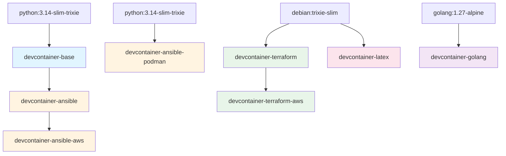

### Build Strategy

> Minor versions above are indicative. The exact digests are pinned in each
> `devcontainers/<stack>/Dockerfile`, which is the only source of truth --
> do not restate a patch version here, it will drift.

- **Base Layer** (`devcontainer-base`): Python foundation with uv and pre-commit
  - Published as `:main`, `:latest` and a Python stream tag derived from the
    image it is built FROM by `scripts/derive-python-tag.sh`. The tag is never
    typed by hand: it read `py313` for a long time while the image shipped
    Python 3.14.
  - Platforms: `linux/amd64`, `linux/arm64`
  - Runs as `vscode`, not root, like every stack built on it

- **Ansible Stacks**
  - `devcontainer-ansible`: built `FROM` `devcontainer-base` (a Dockerfile base, not a devcontainer `extends`)
  - `devcontainer-ansible-podman`: **does not** extend the base. It builds from
    `python:3.14-slim-trixie` and installs Podman from Debian, because the
    Debian build is ABI-coherent with the rest of the image. Copying binaries
    from `quay.io/containers/podman` was tried and never worked at runtime.
  - `devcontainer-ansible-aws`: `devcontainer-ansible` plus `amazon.aws`,
    `boto3`/`botocore` and AWS CLI v2. It is the `ansible-aws` stage of
    `devcontainers/ansible/Dockerfile`, built with `--target ansible-aws`.

- **Standalone Stacks**: Independent base images
  - `devcontainer-terraform`: Debian-based with HashiCorp tools
  - `devcontainer-terraform-aws`: `devcontainer-terraform` plus AWS CLI v2,
    the `terraform-aws` stage of `devcontainers/terraform/Dockerfile`
  - `devcontainer-golang`: Alpine-based Go development (musl). VS Code supports Alpine only as "Alpine Linux 64-bit x86 containers or WSL hosts" and warns that extensions may not work due to `glibc` dependencies in native code; it calls AArch64 "preview" (https://code.visualstudio.com/docs/remote/linux). The image is still published for arm64
  - `devcontainer-latex`: Debian-based with Tectonic engine

## Python Dependency Management Flow

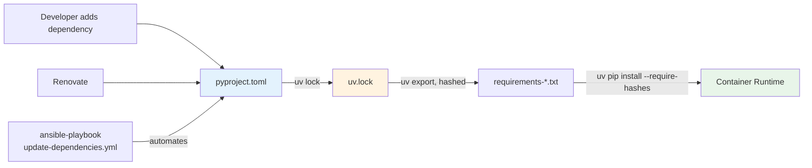

### Workflow

1. **Define dependencies** in `pyproject.toml` with version constraints
2. **Lock versions** with `uv lock` (generates `uv.lock`)
3. **Export** the lock to hashed `requirements-*.txt` (`uv export`); these are generated, never edited by hand
4. **Install in the image** with `uv pip install --system --require-hashes -r requirements-ansible.txt` during build

### requirements files

`requirements-ansible.txt`, `requirements-aws.txt`, `requirements-devcontainer-tools.txt` and `requirements.txt` are generated from `uv.lock` with `uv export` (hashed). The Dockerfiles install them with `--require-hashes`, so a build installs what the lock says and nothing else. Do not edit them by hand: change `pyproject.toml`, run `uv lock`, and regenerate.

## Pre-commit Architecture

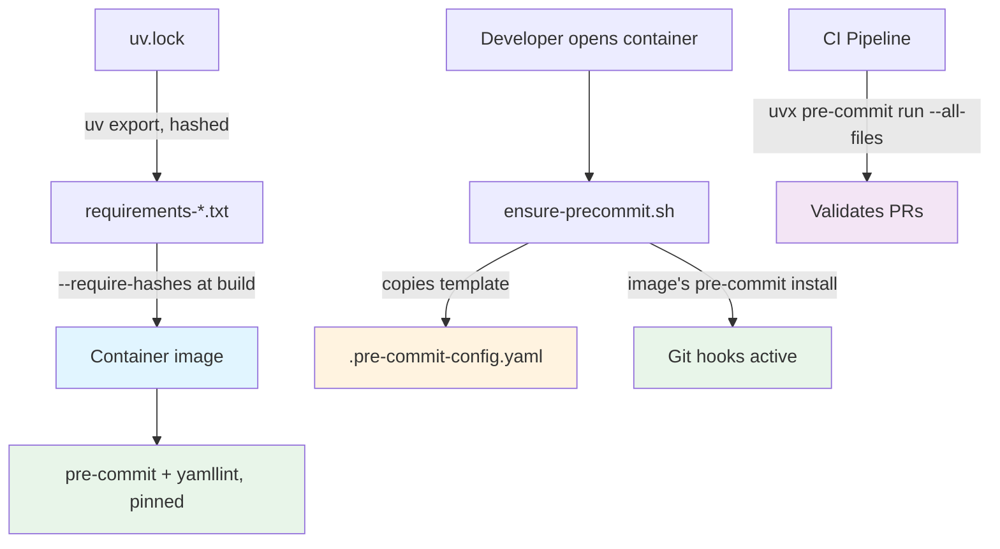

### Pinned at build time

Pre-commit and yamllint are baked into every image, at the versions `uv.lock` pins:

1. **Installed from the lock**: the ansible images from `requirements-ansible.txt`; base, terraform, golang and latex from `requirements-devcontainer-tools.txt` (the `devcontainer-tools` dependency group). Both are `uv export` output with a hash for every package, installed with `--require-hashes --only-binary :all:`.
2. **Their own interpreter where the image has none**: terraform, golang and latex install them into a root-owned venv at `/opt/devcontainer-tools`, on a uv-managed CPython pinned to the base image's version (uv verifies its sha256), and link only `pre-commit` and `yamllint` into `/usr/local/bin`.
3. **Template stored** at `/usr/local/share/devcontainer-skel/<stack>/.pre-commit-config.yaml`
4. **Script provided** at `/usr/local/bin/ensure-precommit`: copies the template and installs the git hook. It installs nothing; without pre-commit on `PATH` it fails, because the image is broken.

Benefits:
- The same pre-commit in every image as in the lock, bumped by Renovate's lock maintenance
- Scanned with the image, instead of downloaded unpinned on every container create
- Nothing to download when the container starts

## CI/CD Pipeline Flow

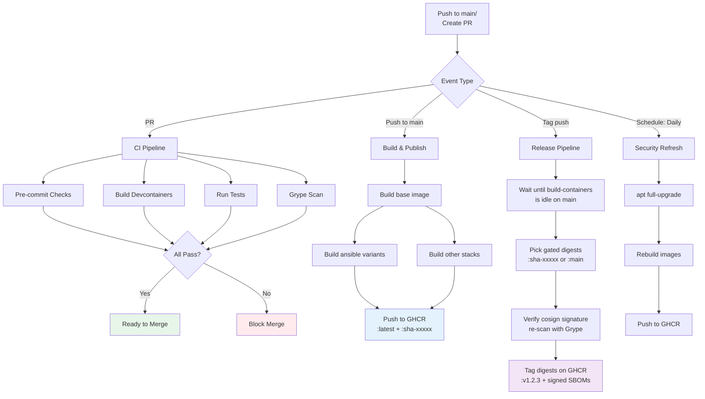

### Build Matrix

The `build-containers.yml` workflow builds:

**build-base job:**
- `devcontainer-base` (always first)

**build-all job matrix:**
- `ansible` (main Dockerfile)
- `ansible` (Dockerfile.podman variant → `ansible-podman`)
- `ansible` (`ansible-aws` target → `ansible-aws`, on the same-run base)
- `terraform`
- `terraform` (`terraform-aws` target → `terraform-aws`)
- `golang`
- `latex` (amd64 only)

### Image Tags

- **On PR**: Build only, no push
- **On push to main** (and the daily run): `:latest`, `:main` and `:sha-<commit>` (the base also gets the derived `py<major><minor>` tag)
- **On tag push**: `:<tag>` only (e.g., `:v1.2.3`; `:py<major><minor>-<tag>` for the base), added to the digest build-containers already gated and signed -- a release rebuilds nothing and never moves `:latest`
- **Daily schedule** (`0 3 * * *`, uncached): Refreshes `:latest` and `:main` with security updates, only for images that pass the scan gate

## Container Variant Comparison

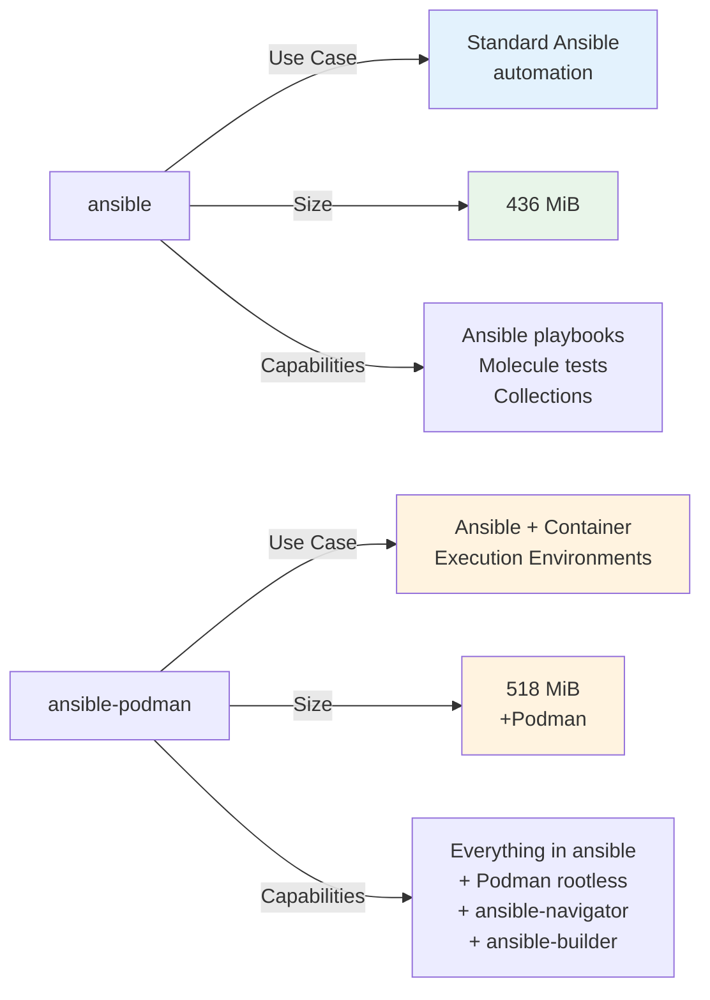

### When to Use Each

**devcontainer-ansible (standard):**
- Traditional Ansible playbook development
- Molecule testing with Docker
- Collection development
- Lighter weight

**devcontainer-ansible-podman:**
- Building Ansible Execution Environments
- Rootless container workflows
- Testing EEs with ansible-navigator
- Working with container-based automation

## Tool Version Strategy

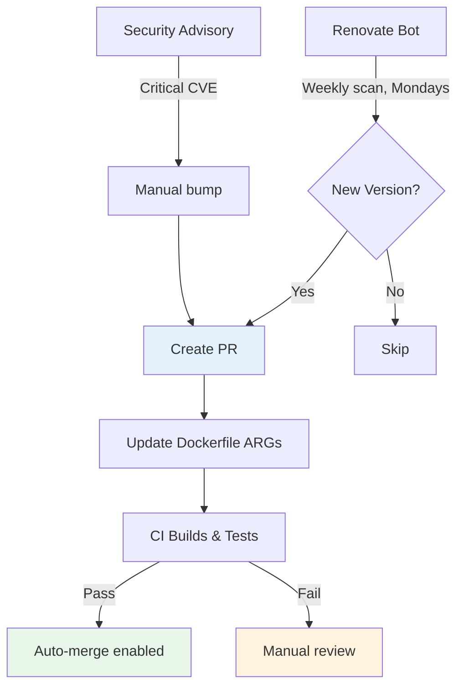

### Where each version lives

Versions are not restated here: a copy rots. Read them at the source.

| Tool | Source of truth | Update strategy |
|------|-----------------|-----------------|
| Python (images) | `FROM python:` in `devcontainers/base/Dockerfile` and `Dockerfile.podman`; `TOOLS_PYTHON_VERSION` where the image has no Python | Renovate, held at 3.14 patches |
| Go | `FROM golang:` in `devcontainers/golang/Dockerfile` | Renovate |
| Terraform, Terragrunt, TFLint, SOPS, age | `ARG *_VERSION` in `devcontainers/terraform/Dockerfile`, each download checksum-verified | Renovate |
| Tectonic | `ARG TECTONIC_VERSION` and the per-architecture sha256 in `devcontainers/latex/Dockerfile` | Renovate |
| ansible-core and the rest of the Python stack | `uv.lock` (exported to `requirements-ansible.txt`) | Renovate lock maintenance |
| uv | `ARG UV_VERSION` in the Dockerfiles | Renovate |
| AWS CLI | v2, `-aws` images only; pinned with its sha256 in `devcontainers/scripts/install-aws-cli.sh` | Renovate |
| GitHub CLI (`gh`) | Not pinned: the latest from GitHub's apt repository at build time | Rebuilt daily |
| Podman | Debian 13's `podman` package, installed in `Dockerfile.podman` | Daily rebuild |

## Security Scanning Flow

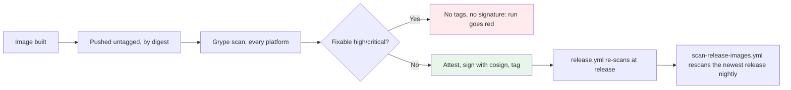

### Exception Policy

`.grype.yaml` holds the exceptions, each with its reason. Third-party Go binaries (terraform, terragrunt, tflint, sops, age, gh, podman) are ignored only for the Go stdlib and `golang.org/x` modules embedded in them, scoped by package and binary location; the golang image's own toolchain is deliberately not covered. A CVE that needs an exception gets a single-CVE entry, never a blanket rule (see the AWS CLI's bundled CPython there).

## Workflow: Adding a New Dependency

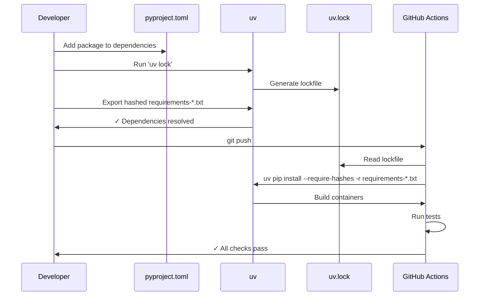

## GHCR Publishing Strategy

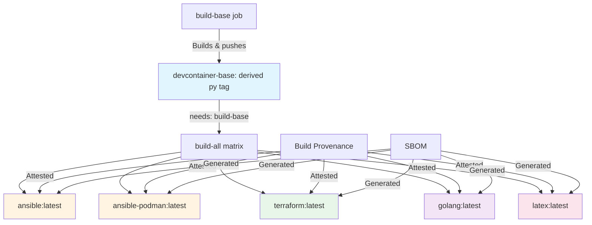

### Image Naming Convention

```
ghcr.io/malpanez/devcontainer-<stack>[variant]:<tag>
```

Examples:
- `ghcr.io/malpanez/devcontainer-base:<derived py tag>` (see scripts/derive-python-tag.sh)
- `ghcr.io/malpanez/devcontainer-ansible:latest`
- `ghcr.io/malpanez/devcontainer-ansible-podman:latest`
- `ghcr.io/malpanez/devcontainer-terraform:sha-5575e8d`
- `ghcr.io/malpanez/devcontainer-golang:v1.2.3`

## Stack Selection Flow

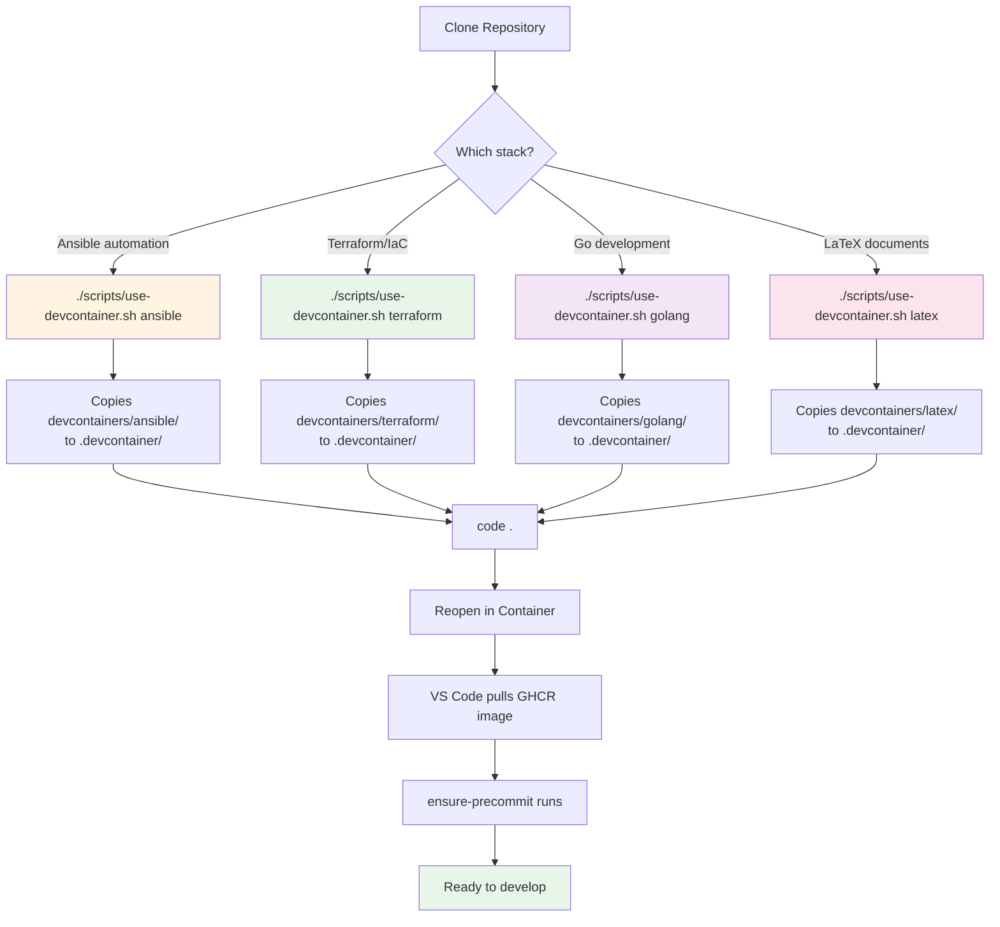

## Multi-Architecture Build

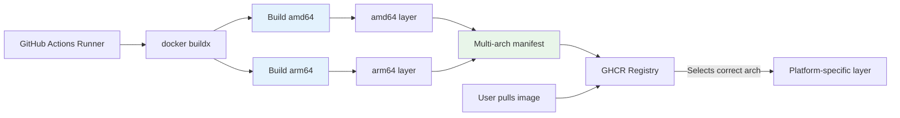

### Platform Support

| Stack | amd64 | arm64 | Notes |
|-------|-------|-------|-------|
| base | ✅ | ✅ | |
| ansible | ✅ | ✅ | |
| ansible-podman | ✅ | ✅ | |
| terraform | ✅ | ✅ | |
| golang | ✅ | ✅ | |
| latex | ✅ | ❌ | The Dockerfile pins an aarch64 Tectonic too, but `build-containers.yml` builds and publishes latex for `linux/amd64` only |
| ansible-aws, terraform-aws | ✅ | ✅ | Stages of the ansible and terraform Dockerfiles |

## Summary

This architecture provides:

1. **Layered container strategy** - Shared base for Python stacks, standalone for others
2. **Modern Python packaging** - pyproject.toml + uv for fast, reproducible builds
3. **Baked-in tooling** - pre-commit and yamllint ship in every image at the versions `uv.lock` pins; nothing is installed when the container starts
4. **Security-first CI/CD** - Grype scan gate before any tag, cosign signatures, provenance attestation, SBOM generation
5. **Multi-arch support** - amd64 + arm64 for all stacks (except latex)
6. **Automated maintenance** - Renovate for dependencies, daily security refreshes

For implementation details, see:
- [README.md](../README.md) - General usage and setup
- [CONTRIBUTING.md](CONTRIBUTING.md) - Development workflow
- [TROUBLESHOOTING.md](TROUBLESHOOTING.md) - Common issues
